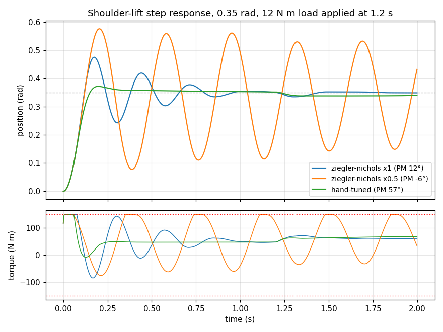

# ros2-industrial-arm-cell-sim

A simulated production cell built around a 6-DoF arm: camera-guided grasp
planning, inverse-kinematics trajectory execution, MoveIt2 collision-aware
planning with OMPL, simulated force and torque feedback for contact inspection,
eye-in-hand calibration, and PLC integration over Modbus.

> ### Clean-room reimplementation
> This repository is an **independent reimplementation of a problem class**,
> built from scratch on personal time using public or synthetic data and
> open-source simulation. It is **not** derived from, and contains no material
> belonging to, any employer or client: no employer source code, schematics,
> calibration data, client data or internal documentation. It exists to
> demonstrate the architecture and engineering approach only. The only
> externally-sourced data in it is the publicly published UR5e DH table.

```
                    camera / light-curtain pillar
                              |
   +--------------------------|-----------------------------+
   |                          |    infeed conveyor           |
   |     [ UR5e on pedestal ] |    ===================>      |
   |            |             |    randomised part poses     |
   |            | eye-in-hand camera on the wrist            |
   |            v                                            |
   |     [ inspection nest on the outfeed bench ]            |
   +----------------------------|----------------------------+
                                | Modbus/TCP
                          [ line PLC ]

  scan -> capture -> segment -> rank grasps -> approach -> close
       -> lift -> transfer -> place -> probe five points -> home
```

---

## The results

Every number below is produced by a script in `analysis/`, needs nothing but
numpy, scipy and pyyaml, and takes minutes on one core. `make report`
regenerates all of them.

### Grasp success over 200 randomised part poses

200 randomised poses per condition, seed 20260101. Part type, resting face,
position within the pick region and yaw are all drawn per trial.

| condition | grasp success | 95% CI | attempted and lost | declined |
|---|---:|---|---:|---:|
| **nominal** | **96.0%** | 92.3–98.0 | 4.0% | 0.0% |
| clutter — a second part on the belt | 94.5% | 90.4–96.9 | 5.0% | 0.5% |
| miscalibrated — 5 mm hand-eye error | 95.0% | 91.0–97.3 | 4.0% | 1.0% |
| noisy — 3× depth noise | 94.0% | 89.8–96.5 | 5.0% | 1.0% |

**The degradations barely move it, and that is the result, not a claim of
robustness I went looking for.** The four intervals overlap; on 200 trials each
this cell is not measurably worse with a neighbouring part on the belt, with
three times the depth noise, or with the hand-eye transform 5 mm out. What
*does* move it is part geometry:

| part | footprint | success |
|---|---|---:|
| bracket_a | 62 × 38 mm | 36/36 — 100% |
| bracket_b | 48 × 48 mm | 34/34 — 100% |
| connector_shell | 90 × 32 mm | 39/39 — 100% |
| pcb_coupon | 100 × 70 × 8 mm | 31/32 — 96.9% |
| spacer_block | 55 × 55 × 55 mm | 33/35 — 94.3% |
| **wide_plate** | **110 × 78 mm** | **19/24 — 79.2%** |

All eight nominal failures are `too_wide` (5) or `finger_collision` (3), and
five of the eight are the 78 mm plate against an 85 mm jaw stroke. With 3.5 mm
of clearance a side, a width estimate two millimetres light is the difference
between a grasp and a collision — and the perception's extent estimate has
about that much spread. This is a gripper problem, not an algorithm problem:
the fix is a wider stroke or a different part presentation, and no amount of
planner tuning recovers it.

**Nothing is declined under nominal conditions and everything that fails is
attempted.** That is the expensive kind of failure, so it is worth being
explicit: this cell drops 4% of parts rather than refusing them. A production
version would add a confidence floor that declines a marginal-width grasp
rather than trying it.

Perception, over the same 200 poses: centroid error median **1.01 mm**
(p95 2.58), yaw error median **0.41°** (p95 6.56).

### Cycle time

Median **9.88 s**, mean 10.39 s, p05 9.39, p95 14.79, over the 192 successful
nominal cycles. Not measured with a stopwatch: every stage contributes a named
segment, and each motion segment's duration comes from time-parameterising the
actual planned path against velocity and acceleration limits scaled to 50% and
35% of the UR5e datasheet figures — because nobody commissions a cell at 100%.

| by kind | | | slowest segments | |
|---|---:|---|---|---:|
| motion | 93.0% | | `to_scan` | 2.60 s |
| gripper | 4.0% | | `to_home` | 1.89 s |
| sensor | 2.3% | | `transfer` | 1.79 s |
| fieldbus | 0.8% | | `to_pregrasp` | 1.33 s |

**43% of the cycle is travelling empty.** The two free moves — `to_scan` at
2.60 s and `to_home` at 1.89 s — are 4.49 s of the 10.39 s mean, and neither
does anything with the part.
Deleting the home pose (it exists so benchmark trials are independent, not
because the cell needs it) and overlapping the scan with the previous retreat
would take out most of that. The fieldbus handshake, which everyone assumes is
the expensive part, is 80 ms.

The spread between the median and the p95 is the cost of a sampling planner:
RRT-Connect occasionally takes an unlucky route that shortcutting does not
fully recover. [docs/cycle-time.md](docs/cycle-time.md)

### Hand-eye calibration

Twenty-five randomised pose sets of each kind:

| pose set | poses | **true** translation error | **true** rotation error | AX−XB residual | board spread | reprojection |
|---|---:|---:|---:|---:|---:|---:|
| thorough | 20 | **0.38 mm** | **0.049°** | 0.81 mm | 0.19 mm | 0.146 px |
| adequate | 10 | **0.61 mm** | **0.143°** | 0.85 mm | 0.21 mm | 0.146 px |
| hurried | 6 | **4.51 mm** | **0.791°** | 1.03 mm | 0.62 mm | 0.146 px |

The hurried calibration is **twelve times worse and looks 27% worse.** Its
reprojection error is identical to three decimal places. Every diagnostic
available on a real robot says it is fine. `AX = XB` fixes the translation of
`X` only from motions whose rotation axes span, nearly-overhead poses rotate
about one axis, and an ill-conditioned least-squares problem does not announce
itself — it returns a confident answer with a small residual. So the
calibration node **refuses to solve** below 25° of axis spread rather than
reporting a residual and letting someone commission it.
[docs/calibration.md](docs/calibration.md)

### What a calibration error costs in grasps

| hand-eye error | 0 mm | 2 mm | 5 mm | 10 mm | 16 mm | 22 mm | 30 mm |
|---|---:|---:|---:|---:|---:|---:|---:|
| grasp success | 100% | 100% | 100% | 98% | 90% | 76% | 54% |
| attempted and lost | 0% | 0% | 0% | 0% | 2% | 6% | 22% |

50 trials each. The cell tolerates about a centimetre and falls apart past two.
Note the shape as well as the size: up to 16 mm the failures are grasps the
cell *declined*, which cost a re-present; by 30 mm nearly half are parts it
tried to pick and dropped, which cost a stopped line.

### Force-feedback contact inspection

At 0.35 N sensor noise, 20 kN/m contact stiffness and 5 mm/s approach, a probe
measures surface height to **8 µm mean, 18 µm p95.**

Seating detection, 20 repeats per row, 0.35° acceptance threshold:

| corner lift | 0.00 | 0.05 | 0.10 | 0.20 | **0.30** | 0.50 | 1.00 mm |
|---|---:|---:|---:|---:|---:|---:|---:|
| detected | 0% | 0% | 0% | 0% | **100%** | 100% | 100% |

**False positives on a correctly seated part: 0%.** The specification this
routine can be held to is: it catches anything over about 0.3 mm and nothing
under 0.2, and it does not cry wolf. [docs/inspection.md](docs/inspection.md)

### Joint controller tuning



Relay auto-tune gives Ku = 1534 N·m/rad, Tu = 0.197 s. Then:

| gain set | overshoot at J=1.6 | phase margin | stable across the inertia sweep |
|---|---:|---:|---|
| Ziegler–Nichols | 35.9% | 11.6° | no — negative margin at J = 3.2 |
| ZN detuned ×0.5 | 64.7% | −5.6° | no — limit-cycles at full torque |
| Hand-tuned | 6.4% | 57.2° | yes — 43° to 68° across the sweep |

**Ziegler–Nichols fails here for a structural reason**, and detuning it makes
it worse rather than better. The ZN rules were fitted to
first-order-plus-dead-time plants; a robot joint with light viscous friction is
close to a double integrator. Halving the gains lowers the crossover to where
the PID's own zeros contribute less phase lead, and the margin goes negative.
Every row is measured twice — a frequency-domain margin and a time-domain step
— and they agree on every row.
[docs/controller-tuning.md](docs/controller-tuning.md)

### Collision-scene validation

An 11×11 grid over the pick region plus a 100 mm margin, at eight grasp
orientations and three heights. The taught region is fully reachable at every
orientation; the swept margin is not, blocked by the far guide rail. A run in
which *everything* is reachable means the obstacles are not in the scene the
checker is using — which is the failure this sweep exists to catch, and which
it did catch, twice.

---

## Quick start

Nothing here needs ROS.

```bash
./scripts/setup.sh          # a venv with numpy, scipy, pyyaml, pymodbus, matplotlib
source .venv/bin/activate
make check                  # lint, 82 tests, and the fast analyses -- a few minutes
```

One cycle, printed stage by stage:

```bash
python scripts/offline_demo.py --seed 4
```

```
cycle 1: pcb_coupon
  presented at (0.715, -0.184) m, yaw +39 deg, footprint 100 x 70 x 8 mm
  perception:  centre off by 0.58 mm, yaw off by 0.17 deg, from 2765 points
  grasp:       3 candidates, best scores 0.727 (approach 1.00, balance 1.00,
               clearance 0.22, contact 1.00, posture 1.00, width 0.33)
               closing at +129 deg across 67.7 mm, jaws opened to 79.7 mm
  timeline:
    to_scan                    2.61 s   motion
    camera_settle              0.15 s   sensor
    to_pregrasp                0.85 s   motion
    descend                    0.52 s   motion
    ...
  verdict:     HELD -- contact 0.2 deg into a 27 deg friction cone,
               engagement 8.0 mm
  inspection:  5 probes, tilt 0.014 deg, mean error 5.7 um, fault 0
  fieldbus:    state 8 (COMPLETE), fault 0 (NONE), last cycle 9595 ms, 1/1 held
  TOTAL:       9.59 s   complete
```

The full benchmark:

```bash
make grasp                  # 200 poses x 4 conditions, about 15 minutes
make report                 # every number above
```

### The simulated cell

ROS 2 Humble, MoveIt2 and Gazebo are needed only to *see* it. The Docker image
is the supported way:

```bash
make docker-demo            # or: ros2 launch cell_bringup cell.launch.py
```

`scripts/run_demo.sh` launches the full stack when ROS is present and falls
back to the offline cycle demo when it is not. A demo that only works on a
machine with a 3 GB installation is not a demo, it is a prerequisite list.

---

## How it is built

**The algorithm is in `<package>/core/`. The ROS node is a wrapper around it.**
Every core module imports numpy, scipy and its siblings, and nothing else — no
`rclpy`, no message types. That is what lets 200 full cycles run in minutes
with no ROS installed, and what makes the tests tests of the algorithms rather
than of the middleware.

| Package | Contents |
|---|---|
| `cell_common` | Transforms and the typed reader for the generated cell description |
| `cell_description` | Generated URDF/xacro for the arm and the cell furniture |
| `cell_motion` | Kinematics, collision model, RRT-Connect, Cartesian planning, time parameterisation, tuning harness, MoveIt2 config |
| `cell_grasping` | Simulated depth camera, perception, grasp planner |
| `cell_calibration` | Eye-in-hand: pose generation, PnP, the AX = XB solve |
| `cell_inspection` | Admittance contact probe and the seating check |
| `cell_fieldbus` | Modbus register map and bridge |
| `cell_bringup` | Launch, and the cycle state machine |

**One source of truth for the geometry.** `simulation/generate_cell.py` holds
the dimensions and emits `cell.yaml`, the Gazebo world and both xacro files.
CI fails if any is stale. The arm description is generated from the same DH
arrays the IK solver uses, so the URDF joint frames *are* the DH frames rather
than a transcription of them.

**Closed-form IK, all eight branches.** A numerical solver returns whichever
branch its seed fell into, so a pose only reachable elbow-up looks unreachable
when the seed was elbow-down — worth several fictitious percentage points of
grasp success over 200 poses.

**The boundary that makes the benchmark mean anything.** The pick pipeline sees
the depth image and the *calibrated* hand-eye transform. Ground truth enters in
exactly one place: `evaluate_grasp`, at the end, to decide whether the grasp
held.

[docs/architecture.md](docs/architecture.md)

---

## What a failure means

Every failure is attributed to the stage that produced it, and split into two
classes that cost very different amounts:

- **Declined** — perception found nothing, or no candidate scored above the
  feasibility floor. Cheap: the part goes round again.
- **Attempted and lost** — the jaws closed and the part did not come. Expensive:
  a dropped part is a stopped line.

A cell at 95% made of 5% dropped is worse than one at 90% made of 10%
declined, so both are reported. The six ground-truth criteria a grasp must
satisfy — the antipodal friction-cone condition, jaw stroke, pad engagement,
grasp-line intersection, torsional slip and finger clearance — are in
`cell_bringup/core/outcome.py`.

---

## Documentation

| | |
|---|---|
| [architecture.md](docs/architecture.md) | How the pieces fit, and the DH-to-URDF off-by-one that a test caught |
| [grasp-planning.md](docs/grasp-planning.md) | The pipeline, the scoring, and three decisions that were wrong first |
| [cycle-time.md](docs/cycle-time.md) | Where the seconds go and what each responds to |
| [calibration.md](docs/calibration.md) | Why a good residual is not evidence of a good calibration |
| [inspection.md](docs/inspection.md) | The probe's error budget, measured term by term |
| [controller-tuning.md](docs/controller-tuning.md) | Why Ziegler–Nichols fails on a robot joint |
| [fieldbus.md](docs/fieldbus.md) | The register map, the fault codes, and the PLC-facing contract |
| [limitations.md](docs/limitations.md) | What this does not do |

---

## Limitations

The short version; the full list is [docs/limitations.md](docs/limitations.md).

- **No dynamics.** The arm is kinematic. Trajectories respect velocity and
  acceleration limits; nothing computes joint torques during a move.
- **Rigid parts, rigid pads.** A grasp holds or does not, by geometry and a
  friction cone. Real jaws often *centre* a part as they close, which forgives
  a millimetre or two; this model does not, so its off-centre failures are
  pessimistic.
- **Matte boxes only.** The depth model has range-dependent noise, dropout,
  quantisation and a working range. It has no model of specular reflection or
  transparency, which are what actually break depth cameras in a factory.
- **The parts are boxes and the estimator fits a box.** Convenient, and it
  flatters the result.
- **Modbus is real; EtherNet/IP is not.** `docs/fieldbus.md` describes what the
  equivalent CIP assemblies would carry, which is not the same as having
  written them.
- **The nominal benchmark is a benign scenario.** One part, no occlusion, a
  correct calibration, a healthy camera. That is why the other three conditions
  and the sensitivity curve are there.
- **Success is judged by a model, not by physics.** A Gazebo or MuJoCo grasp
  with real contact dynamics would disagree at the margins, and the direction
  of that disagreement is unknown.

---

## Licence

MIT. See [LICENSE](LICENSE).
