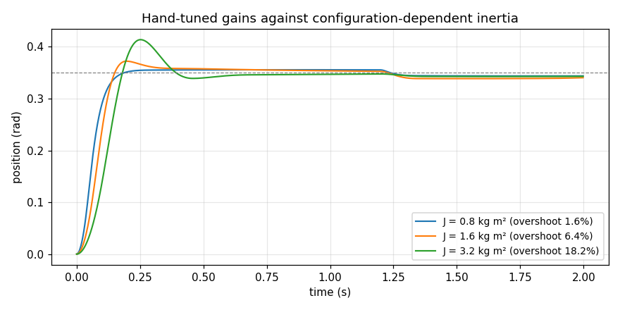

# Joint controller tuning

A tuning record for the shoulder-lift axis: relay auto-tune, three gain sets,
step responses, an inertia sweep, and the stability margins that explain the
results. Reproduce with:

```bash
make tuning
```

## The plant

One axis as the position loop sees it:

```
J q̈ + b q̇ + τ_coulomb·sign(q̇) + τ_gravity(q) = τ_motor
```

with the motor torque passed through a 2 ms current-loop lag and clipped at
150 N·m. Nominal values: `J` = 1.6 kg·m², `b` = 3 N·m·s/rad, Coulomb 4 N·m,
gravity 55 N·m peak at horizontal.

Each term breaks a different tuning rule:

- **Inertia** varies with configuration — a UR5e's shoulder sees several times
  more with the arm out than tucked — so a gain set tuned at one pose is the
  wrong gain at another. The harness sweeps 0.8 to 3.2 kg·m².
- **Viscous friction** is the benign term, and it is what Ziegler–Nichols
  implicitly assumes dominates. Here it does not.
- **Coulomb friction** is not smooth, so it leaves a steady-state error that
  proportional gain cannot remove and integral gain removes only by winding up
  first.
- **Gravity** is configuration-dependent, so a step in position is also a step
  in load.

Gravity feedforward is applied at 90% — not 100%. A real feedforward model is
built from estimated link masses and is a few per cent wrong, so the loop still
has something to reject.

## Relay auto-tune

Åström–Hägglund, with a hysteresis band. Result:

```
Ku = 1534 N·m/rad      Tu = 0.197 s      (31.8 rad/s)
```

The hysteresis is not optional. Without it the relay chatters on sensor noise
at the control rate, and the "limit cycle" it measures is the sample period —
which yields an ultimate gain about two orders of magnitude too high, and an
auto-tune that confidently returns gains that would tear the axis apart.

Sanity check on the number: the linear plant `1/(Js² + bs)` is stable under any
proportional gain, so `Ku` is finite here only because of the 2 ms current-loop
lag. The predicted crossing is at `ω² = 1/(0.533 × 0.002)`, giving 30.6 rad/s
against the measured 31.8 — which is the right answer arriving for the right
reason.

## The three gain sets

| | Kp | Ki | Kd |
|---|---:|---:|---:|
| Ziegler–Nichols | 921 | 9330 | 22.7 |
| ZN detuned ×0.5 | 460 | 4665 | 11.4 |
| Hand-tuned (what the cell runs) | 900 | 1200 | 45.0 |

## Results

Step of 0.35 rad, 12 N·m load applied at 1.2 s, 90% gravity feedforward:

| gain set | J | rise | overshoot | settling | steady-state | **phase margin** | stable |
|---|---:|---:|---:|---:|---:|---:|---|
| Ziegler–Nichols | 0.8 | 57 ms | 24.2% | 1388 ms | 0.6 mrad | **33.9°** | yes |
| Ziegler–Nichols | 1.6 | 76 ms | 35.9% | 1390 ms | −0.6 mrad | **11.6°** | marginal |
| Ziegler–Nichols | 3.2 | 104 ms | 46.3% | — | −26 mrad | **−8.6°** | **no** |
| ZN ×0.5 | 0.8 | 59 ms | 47.1% | 1432 ms | −0.1 mrad | **15.8°** | yes |
| ZN ×0.5 | 1.6 | 77 ms | 64.7% | — | −63 mrad | **−5.6°** | **no** |
| ZN ×0.5 | 3.2 | 105 ms | 90.0% | — | −673 mrad | **−23.3°** | **no** |
| Hand-tuned | 0.8 | 92 ms | 1.6% | 1232 ms | −6.3 mrad | **68.0°** | yes |
| Hand-tuned | 1.6 | 93 ms | 6.4% | 1246 ms | −10.2 mrad | **57.2°** | yes |
| Hand-tuned | 3.2 | 114 ms | 18.2% | 392 ms | −7.2 mrad | **42.6°** | yes |




## What this says

**Ziegler–Nichols does badly here, for a structural reason.** The ZN rules were
fitted to first-order-plus-dead-time plants. A robot joint with light viscous
friction is close to a *double integrator*, which is outside that family. At
nominal inertia the ZN gains land the loop at 11.6° of phase margin — nominally
stable, 36% overshoot, and nothing you would run near a person. At the inertia
the arm sees extended, the margin goes negative.

**Detuning it makes it worse, not better.** This is the counter-intuitive one.
Halving all three gains keeps the integral and derivative *times* fixed and
lowers the crossover from 24 to 17 rad/s — and at the lower crossover the PID's
own zeros (a double zero at −20.3 rad/s) contribute less phase lead. The margin
falls from +11.6° to −5.6°. The simulated response duly limit-cycles at full
torque: ±0.25 rad, the drive slamming between ±150 N·m.

The usual reflex when an auto-tune is too aggressive is to scale it back. On
this plant that is precisely wrong.

**The hand-tuned gains hold 43–68° of margin across the whole inertia sweep**
by using a much longer integral time (Ti = 0.75 s against ZN's 0.099 s) and
twice the derivative gain. Reached by hand: raise Kd until the step is
critically damped, raise Kp until the torque saturates on a full-speed move,
then add the least integral action that removes the Coulomb offset within a
second.

## Why two methods of measurement

Every row is measured twice — a frequency-domain phase margin from the
linearised loop, and a time-domain step response of the full nonlinear plant.
They agree on every row: positive margin, bounded overshoot; negative margin,
limit cycle. If they had disagreed, one of them would have been wrong, and a
tuning record with one number per row gives you no way to know which.

## Anti-windup, and a saturation lesson

Clamping anti-windup: stop integrating while the drive is against its limit.
Without it a 0.35 rad step winds up about 40 N·m of integral that has to be
unwound *through* the target, which reads as an oscillation and gets
misdiagnosed as too much proportional gain.

It is worth being clear about what anti-windup does and does not fix. Clamping
prevents further accumulation while saturated; it does not remove the integral
already accumulated before saturation. Running the same comparison with
`gravity_feedforward=0.0` — where the integrator alone must supply the 52 N·m
that holds the axis up — shows the detuned gains limit-cycling harder still.
That column is in `results/pid_tuning.json` and is the clearest demonstration
here that a tuning rule derived for a linear plant says nothing about one with
a saturating actuator.
